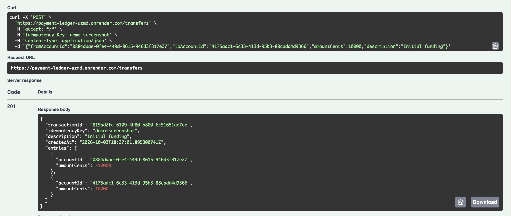
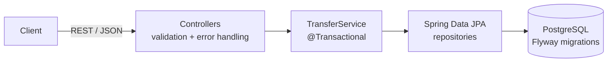

# Payment Ledger

[](https://github.com/Kmsasaleh/payment-ledger/actions/workflows/ci.yml)

A double-entry payment ledger API built with Java and Spring Boot. It moves money between accounts the way real payment systems do: every transfer is recorded as balanced debit and credit entries, retried requests never charge twice, and concurrent transfers can't overdraw an account.

**Live API (interactive docs):** https://payment-ledger-uzmd.onrender.com

## Try the live demo

Open the [interactive docs](https://payment-ledger-uzmd.onrender.com) (it may take a minute to wake up), then for each step click the endpoint, **Try it out**, paste the body, and **Execute**.

1. **POST /accounts:** create a funding source, then copy its `id`
```json
   {"name":"Funding","type":"SYSTEM","currency":"CAD"}
```
2. **POST /accounts:** create a user, then copy its `id`
```json
   {"name":"Alice","type":"USER","currency":"CAD"}
```
3. **POST /transfers:** set `Idempotency-Key` to any unique text (e.g. `demo-1`) and send $100 to Alice
```json
   {"fromAccountId":"<funding id>","toAccountId":"<alice id>","amountCents":10000,"description":"Initial funding"}
```
Expected: `201` with two entries, `-10000` and `+10000`.
4. **GET /accounts/{id}:** Alice's `balanceCents` is `10000`.
5. **Repeat step 3 with the same key:** you get the same `transactionId` back, and Alice's balance stays `10000`.
6. **Send Alice 1000000 cents with a new key:** rejected with `422 Insufficient funds`.


## Features

- **Double-entry accounting**: every transaction writes entries that sum to zero, so money is never created or lost
- **Derived balances**: an account's balance is always the sum of its entries, with no balance column that can drift out of sync
- **Idempotent transfers**: clients send an `Idempotency-Key` header, and retries return the original result instead of moving money again
- **Overdraft protection**: user accounts can't go below zero; system accounts (like funding sources) can
- **Concurrency-safe**: pessimistic row locking with consistent lock ordering prevents both overdraft races and deadlocks
- **AI fraud triage before posting**: an LLM decision model (TypeSafe Jev) scores each user-to-user transfer, and code-owned rules approve, block, or hold it. Blocked and held transfers never create ledger entries ([details](#fraud-triage-with-jev))
- **Integration tests on real Postgres** via Testcontainers, run automatically on every push with GitHub Actions

## Tech stack

Java 21 · Spring Boot 4 · Spring Data JPA / Hibernate · PostgreSQL · Flyway · Testcontainers · JUnit 5 · Docker · GitHub Actions · Render · Neon

## Architecture



The schema has three tables:

| Table | Purpose |
|---|---|
| `accounts` | Buckets that hold money (`USER` or `SYSTEM`), each with a currency |
| `transactions` | One row per business event, with a unique idempotency key |
| `entries` | Signed amounts in cents; each transaction's entries sum to zero |

A $25 transfer from Alice to Bob creates one transaction with two entries: `-2500` on Alice and `+2500` on Bob.

## The concurrency bug, and the fix

The first version of the transfer logic read the sender's balance, checked it, then wrote new entries. Under concurrent load that's a race condition: several requests can read the same balance before any of them commits.

`TransferServiceTest.concurrentTransfersCannotOverdrawAccount` reproduces it. Alice starts with $100 and ten threads each try to send $20 at the same instant. Before the fix, **all ten succeeded** and her balance ended at **-$100**.

The fix locks both account rows with `SELECT ... FOR UPDATE` before checking the balance, so transfers touching the same account run one at a time. Locks are always acquired in a consistent order (smaller account ID first), so two opposite transfers (Alice→Bob and Bob→Alice) can't deadlock each other. After the fix, exactly five transfers succeed and Alice ends at exactly $0.

The commit history shows both steps: the test exposing the bug, then the fix.

## Fraud triage with Jev

Before a user-to-user transfer posts, the service asks [Jev](https://vercel.com/docs/ai-gateway/sdks-and-apis/typesafe), TypeSafe AI's typed decision model, for a judgment. **Jev only gives a judgment; this service makes the decision.**

```
POST /transfers
  1. Idempotency check (decision table)   same key + same body -> replay stored outcome, no new Jev call
                                           same key + different body -> 409
  2. Cheap validation, no locks            bad input / insufficient funds -> 400/422, no Jev call
  3. SYSTEM source (deposit)?              skip triage
  4. Build features from ledger history    amount vs median, prior payments to recipient, 10-min velocity, hour, account age
  5. Call Jev (outside any DB transaction, 1 s connect / 2 s read timeout, no retries)
  6. FraudTriagePolicy decides             APPROVE / BLOCK / HOLD
  7. APPROVE -> one DB transaction: lock accounts, re-check balance, write entries + decision row
     BLOCK / HOLD -> write the decision row only
```

**What Jev is asked** (one request per transfer): `fraud_risk` as a choice of `low` / `medium` / `high`, plus four yes/no reason flags: `unusual_amount`, `new_recipient`, `velocity_spike`, `odd_time`.

**Decision policy** (thresholds live in `application.properties`; the defaults are untuned):

| Jev result | Outcome |
|---|---|
| Error, timeout, bad response, missing API key, or daily call cap reached | HOLD (`JEV_UNAVAILABLE`), never approve |
| Confidence below `fraud.triage.min-confidence` (0.80) | HOLD (`LOW_CONFIDENCE`) |
| `high` | BLOCK (`HIGH_RISK`); flags at or above `fraud.triage.flag-threshold` (0.5) are logged as reasons |
| `medium` | HOLD (`MEDIUM_RISK`) |
| `low` | APPROVE (`LOW_RISK`) |

### How it's kept safe

- **Blocked or held transfers can't touch the ledger.** Entries are only written through `transactions`, and a database `CHECK` constraint on `transfer_decisions` rejects any BLOCKED or HELD row linked to a transaction. A test bypasses the Java code and confirms Postgres refuses it (SQLSTATE `23514`).
- **Fails closed.** Any Jev failure holds the transfer. The policy has exactly one code path that returns APPROVE.
- **The network call stays outside the database transaction.** Posting holds `SELECT ... FOR UPDATE` row locks, and a slow model call inside that transaction would block every transfer on those accounts.
- **Reasons aren't returned to the caller.** They're stored and logged, but telling a fraudster which signal tripped would help them avoid it.
- **Cost controls.** No Jev call on idempotent replays, failed validation, or deposits; no retries; an in-memory daily call cap; a spend limit on the gateway key. Tests and CI use a fake client and never call the real API.

### Measured results

Live run on the deployed service on 2026-11-16: 40 synthetic transfers from new accounts, one Jev call each ([`scripts/measure_triage.py`](scripts/measure_triage.py); Jev numbers come from the `transfer_decisions` table).

| Metric | Result |
|---|---|
| Jev calls answered | 40 / 40 |
| Jev latency | p50 132 ms, p95 296 ms |
| End-to-end `POST /transfers` latency (client-side, includes internet round trip) | p50 340 ms, p95 693 ms |
| Input tokens | 20,327 (about 508 per call) |
| Estimated cost | $0.00085 total, about $0.02 per 1,000 decisions (tokens x $0.042 per million) |
| Outcomes | 7 BLOCKED, 33 HELD (`LOW_CONFIDENCE`), 0 APPROVED |

All 5 simulated account-takeover transfers ($2,500 from a brand-new account to a new recipient) were blocked. **No transfer was approved**, including 12 small repeat payments to the same person.

### Known limitations

- **It's too conservative for new accounts.** Jev's confidence stayed below the 0.80 threshold for every lower-risk transfer, so nothing was approved.
- **Cold start.** Held transfers don't post, so they don't count as history. A new sender's twelfth payment to the same person still looks like their first.
- **No review path.** There's no endpoint or UI to release or reject a held transfer, and a hold doesn't reserve funds.
- **Thresholds are untuned.** Tuning needs labeled real transactions; the synthetic data here proves the wiring, not detection accuracy.
- **`odd_time` uses UTC**, because accounts have no timezone.
- **The daily call cap is in memory**, so it resets on restart and isn't shared across instances.

## API

The examples use `localhost:8080`. To try the live version, replace it with `https://payment-ledger-uzmd.onrender.com`.

### Create an account

```bash
curl -X POST localhost:8080/accounts \
  -H "Content-Type: application/json" \
  -d '{"name":"Alice","type":"USER","currency":"CAD"}'
```

### Transfer money

```bash
curl -X POST localhost:8080/transfers \
  -H "Content-Type: application/json" \
  -H "Idempotency-Key: alice-bob-1" \
  -d '{"fromAccountId":"<id>","toAccountId":"<id>","amountCents":2500,"description":"Dinner"}'
```

### Get an account and its balance

```bash
curl localhost:8080/accounts/<id>
```

Possible `POST /transfers` responses:

| Status | Meaning |
|---|---|
| `201` | Approved (or a SYSTEM-source deposit) and posted: body has the transaction and its entries |
| `202` | Held for review: `{"decisionId": "...", "status": "PENDING_REVIEW"}`, no entries written |
| `422` | Blocked by fraud triage (`{"decisionId": "...", "status": "BLOCKED"}`), or insufficient funds (`ProblemDetail`) |
| `409` | The `Idempotency-Key` was already used with a different request body |
| `400` | Invalid request |

Errors use the standard `ProblemDetail` JSON format.

## Running locally

Requires Java 21 and Docker.

```bash
docker compose up -d        # start Postgres
./mvnw spring-boot:run      # start the API on localhost:8080
```

Flyway creates the schema automatically on startup.

## Running the tests

```bash
./mvnw test
```

Testcontainers starts a throwaway Postgres in Docker, so tests never touch your local data.

## Deployment

The app is packaged as a multi-stage Docker image and deployed on Render, with a managed Neon PostgreSQL database. Database credentials are supplied through environment variables (`DB_URL`, `DB_USERNAME`, `DB_PASSWORD`), so no secrets live in the code. Every push to `main` runs the test suite in GitHub Actions and redeploys automatically.

## Design decisions

- **Money as integer cents (`BIGINT`)**, never floating point, to avoid rounding errors
- **Immutable entries**: mistakes are corrected with new entries, never by editing history
- **Flyway owns the schema**, and Hibernate only validates against it (`ddl-auto=validate`)
- **DTOs (Java records) at the API boundary**, so database entities never leak into the API
- **Jev is called over plain HTTP from Java** through Vercel AI Gateway. The official SDKs are Python and TypeScript, and running a separate sidecar service only for them would add cost and another way to fail

## Roadmap

- A review endpoint to release or reject held transfers
- Tuning triage thresholds on labeled data
- Reversal transactions
- Reconciliation against an external statement
- API key authentication for the live demo